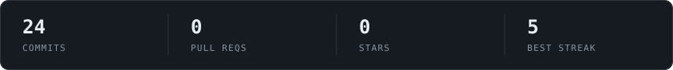
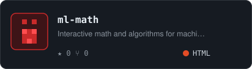
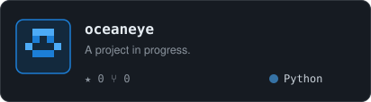
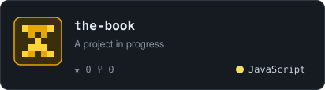
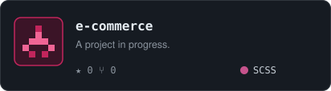
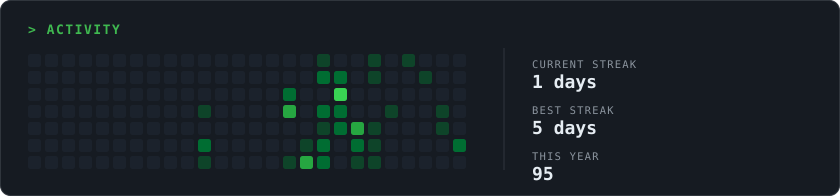

  

  The window shows the weather in Phnom Penh, Cambodia right now. The monitor scrolls my latest commits. The shelf holds a book for each language I write. 
  <a href="https://github.com/thegeostar">GitHub</a>

  

  

### `> PROJECTS`

<table>
  <tr>
    <td width="50%" align="center">
      
    </td>
    <td width="50%" align="center">
      
    </td>
  </tr>
  <tr>
    <td width="50%" align="center">
      
    </td>
    <td width="50%" align="center">
      
    </td>
  </tr>
</table>

  

